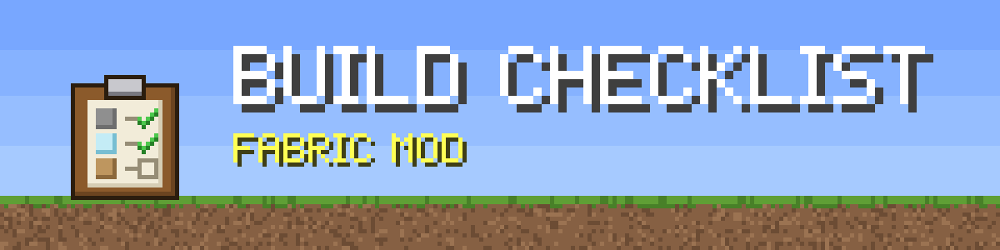

# Build Checklist

A client-side Fabric mod that keeps a list of the materials you need for a build and shows it on your HUD.
Items tick themselves off as you collect them, so you always know what is still missing.

Because it is purely client-side, it works in singleplayer **and on vanilla multiplayer servers**. The server never needs the mod.

<!-- Screenshots: replace the placeholders below -->


## Features

- Material checklist on the HUD (top-left corner) with item icon, name and `have / need` (e.g. `23/64`)
- Color coding: **red** = missing, **yellow** = partially collected, **green + ✔** = done
- "Checklist complete!" message when the last item is collected
- Counts items across the whole inventory (including armor and offhand), **inside shulker boxes and bundles** you carry, and in the **container you have open** (chest, barrel, ender chest...). Recounted twice per second, not every frame.
- Toggle the HUD with a key (default **H**, rebindable in *Options → Controls*)
- Checklist editor screen (default key **G**): search all items and click to add them, no typing in chat needed
- **Multiple named checklists** per world, e.g. one for the castle and one for the farm
- The list is saved automatically, **separately for every world and server**
- English and Czech translations

## Checklist editor (GUI)

Press **G** (rebindable in *Options → Controls*) to open the editor.

- **Left:** search box and a grid of all items. Search by name (in your game language) or by ID (`stone`).
  - Click an item: add one stack (64, or 16 / 1 for items that stack less)
  - Shift + click: add 1
- **Right:** your current checklist.
  - `[<]` / `[>]`: switch between your checklists, `[+]`: create a new one
  - Click a count to type an exact number (Enter = confirm, Esc = cancel)
  - `[+]` / `[−]`: change the count by one stack (Shift: by 1). Reaching 0 removes the item.
  - `[×]`: remove the item
- Mouse wheel scrolls the side the cursor is on.

## Commands

All commands are client-side (`/checklist` never reaches the server).

| Command | Description |
|---|---|
| `/checklist add <item> <count>` | Add an item (with item ID autocomplete). Adding the same item again sums the counts. |
| `/checklist addhand <count>` | Add the item in your main hand. |
| `/checklist remove <item>` | Remove an item from the list. |
| `/checklist clear` | Remove everything. |
| `/checklist list` | Print the active list to chat. |
| `/checklist lists` | Show all checklists of this world/server. |
| `/checklist new <name>` | Create a new empty checklist and switch to it. |
| `/checklist switch <name>` | Switch to another checklist. |
| `/checklist delete <name>` | Delete a checklist (the last one can't be deleted). |

Example:

```
/checklist add minecraft:stone 64
/checklist add glass 32
```

## Installation

1. Install [Fabric Loader](https://fabricmc.net/use/) for **Minecraft 26.3**.
2. Download [Fabric API](https://modrinth.com/mod/fabric-api) and put it in your `mods` folder.
3. Put `build-checklist-<version>.jar` in your `mods` folder.

Requirements: Minecraft 26.3, Fabric Loader ≥ 0.20.1, Fabric API, Java 25+.

## Where is the list stored?

`.minecraft/config/buildchecklist/`, one JSON file per world (`sp_<world folder>.json`) or server (`mp_<server address>.json`), holding all checklists of that world.
If a file can't be read, it is renamed to `*.json.broken` instead of being overwritten.

## Building from source

```bash
./gradlew build      # compiles, runs the tests; the jar ends up in build/libs/
./gradlew runClient  # start a development client with the mod
```

The icon and banner are pixel art generated by `python3 tools/make_art.py` (no extra dependencies).

## Planned

- Importing materials from Litematica schematics
- Configurable HUD position and size (Mod Menu)

## License

[MIT](LICENSE)
